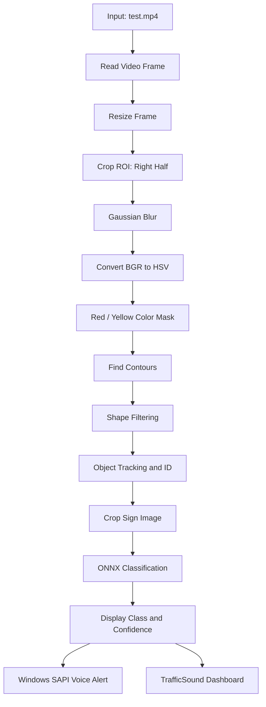
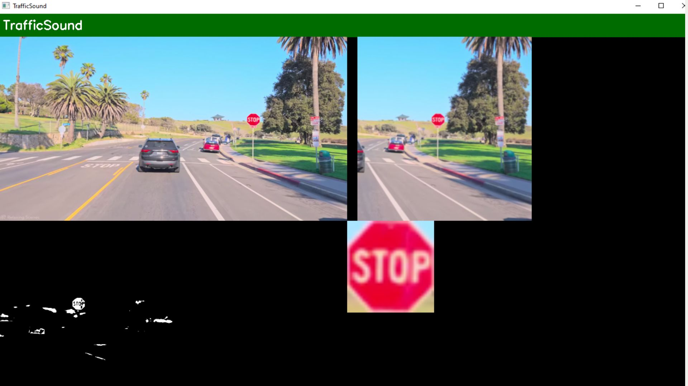

# TrafficSound
ระบบตรวจจับและจำแนกป้ายจราจร พร้อมเสียงแจ้งเตือน ที่พัฒนาด้วยภาษา **C++**, **OpenCV** และโมเดล Deep Learning

โปรเจกต์นี้ใช้การประมวลผลภาพเพื่อตรวจหาบริเวณที่มีสีและรูปร่างใกล้เคียงกับป้ายจราจร จากนั้นติดตามตำแหน่งป้ายในแต่ละเฟรม ส่งภาพบริเวณป้ายเข้าโมเดลจำแนกประเภท และใช้ Windows Speech API (SAPI) อ่านผลการจำแนกออกเสียง

---
## เทคโนโลยีที่ใช้

| เทคโนโลยี          | หน้าที่                                                                        |
| --------------------------- | ------------------------------------------------------------------------------------- |
| C++20                       | ภาษาหลักในการพัฒนา                                                  |
| OpenCV 4.12                 | อ่านวิดีโอ ประมวลผลภาพ ตรวจจับ Contour และแสดงผล |
| OpenCV DNN                  | โหลดและประมวลผลโมเดล ONNX                                         |
| ONNX                        | รูปแบบไฟล์โมเดลสำหรับการจำแนกภาพ                      |
| Microsoft Speech API (SAPI) | แปลงข้อความเป็นเสียงพูดบน Windows                            |
| Visual Studio               | IDE และ Build System                                                               |

---

## ภาพรวมการทำงาน (Workflow)



## รายละเอียดกระบวนการ

### 1. อ่านและเตรียมวิดีโอ

โปรแกรมเปิดวิดีโอจาก `test.mp4` ด้วย `cv::VideoCapture` และย่อขนาดเฟรมลงเหลือ 50% ของขนาดเดิมก่อนประมวลผล

### 2. ตรวจจับบริเวณป้ายด้วยสีและรูปร่าง

1. กำหนด ROI เป็นพื้นที่ครึ่งขวาของภาพ
2. ใช้ Gaussian Blur ลดสัญญาณรบกวน
3. แปลงภาพจาก BGR เป็น HSV
4. สร้าง Mask สำหรับสีแดง (ครอบคลุมช่วง Hue ที่ปลายทั้งสองด้าน) และสีเหลือง
5. รวม Mask แล้วค้นหา Contour ภายนอก
6. กรอง Contour ตามพื้นที่ รูปร่าง ความนูน และอัตราส่วนกว้างต่อสูง ตรวจจับจากการคัดกรองจากสีและรูปทรง ไม่ใช่การใช้โมเดล Object Detection โดยตรง

### 3. ติดตามวัตถุ (Object Tracking)

ระบบสร้างออบเจ็กต์ `TrackedSign` เพื่อเก็บข้อมูลของป้ายแต่ละชิ้น ได้แก่

- `id`: หมายเลขประจำวัตถุ
- `rect`: กรอบ Bounding Box
- `center`: จุดกึ่งกลางของกรอบ
- `inactive_frames`: จำนวนเฟรมที่ไม่พบวัตถุ
- `crop`: ภาพบริเวณป้ายสำหรับส่งเข้าโมเดล
- `aiLabel`: ผลการจำแนกจาก AI
- `hasAnnounced`: สถานะป้องกันการแจ้งเตือนซ้ำ


### 4. จำแนกประเภทด้วย AI

โปรแกรมโหลดโมเดล `yolov8_cls_5class.onnx` และชื่อคลาสจาก `label.txt` ผ่าน OpenCV DNN

ขั้นตอนหลัก:

1. ตัดภาพบริเวณป้ายจากเฟรม
2. ปรับขนาดภาพก่อนส่งเข้าโมเดล
3. สร้าง Input Blob ด้วย `blobFromImage`
4. เรียก `forward()` เพื่อรับผลลัพธ์จากโมเดล
5. เลือกคลาสที่มีคะแนนสูงสุด
6. หากคะแนนต่ำกว่า 0.50 จะแสดงผลเป็น `Uncertain`

### 5. แจ้งเตือนด้วยเสียง

เมื่อ Track ได้รับผลการจำแนกแล้ว โปรแกรมใช้ `ISpVoice` จาก Windows Speech API เพื่ออ่านข้อความออกเสียง โดยแยกการทำงานไปยัง Thread เพื่อไม่ให้ขั้นตอนแสดงภาพต้องรอจนกว่าการพูดจะเสร็จ

ระบบใช้ `hasAnnounced` เพื่อป้องกันการอ่านชื่อคลาสซ้ำสำหรับ Track เดิม และข้ามการพูดเมื่อผลลัพธ์เป็น `background`

### 6. แสดงผล Dashboard

หน้าต่าง `TrafficSound` ถูกจัดวางเป็นส่วนต่าง ๆ ได้แก่

- ภาพวิดีโอพร้อมกรอบและผลการจำแนก
- ภาพ ROI ที่ใช้ตรวจจับ
- ภาพ Color Mask
- ภาพ Crop ล่าสุดที่ส่งให้ AI

กดปุ่ม `ESC` เพื่อออกจากการแสดงผล

---

## โครงสร้างไฟล์

โครงสร้างไฟล์ที่ตรวจสอบพบใน Repository:

```text
TrafficSound/
├── TrafficSound.slnx
└── TrafficSound/
    ├── TrafficSound.cpp
    ├── detrack.cpp
    ├── TrafficSound.vcxproj
    └── TrafficSound.vcxproj.filters
```

## การติดตั้ง
### เปิดและ Build โปรเจกต์

1. Clone Repository

   ```bash
   git clone https://github.com/kkshaolin/TrafficSound.git
   cd TrafficSound
   ```
2. เปิดไฟล์ `TrafficSound.slnx` ด้วย Visual Studio รุ่นที่รองรับ Solution Format นี้
3. ตรวจสอบ Configuration เป็น `x64` และตั้งค่า OpenCV ให้ถูกต้อง
4. วางไฟล์ `test.mp4`, `yolov8_cls_5class.onnx` และ `label.txt` ใน Working Directory ที่โปรแกรมใช้ค้นหาไฟล์
5. Build Solution
6. Run โปรแกรม

---

## ผลลัพธ์ของระบบ (Expected Output)



---

## แนวทางพัฒนาต่อ

1. เปลี่ยนการตรวจจับจาก Color + Contour เป็น Object Detection Model เพื่อรองรับป้ายที่มีสีหรือมุมมองหลากหลายขึ้น
2. ปรับปรุง Tracking ด้วย Kalman Filter หรือ SORT/DeepSORT
3. เพิ่มการตั้งค่า Confidence Threshold ผ่านไฟล์ Configuration
4. แสดง Confidence Score บน Dashboard
5. เพิ่มระบบเลือกไฟล์วิดีโอหรือรองรับกล้องแบบ Real-time
6. ปรับปรุงระบบ Voice Alert ให้จัดคิวเสียงและป้องกันการพูดซ้อนกัน
7. เพิ่มการบันทึกผลการตรวจจับ เช่น เวลา, Track ID, Class และ Confidence

---
